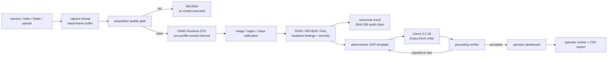
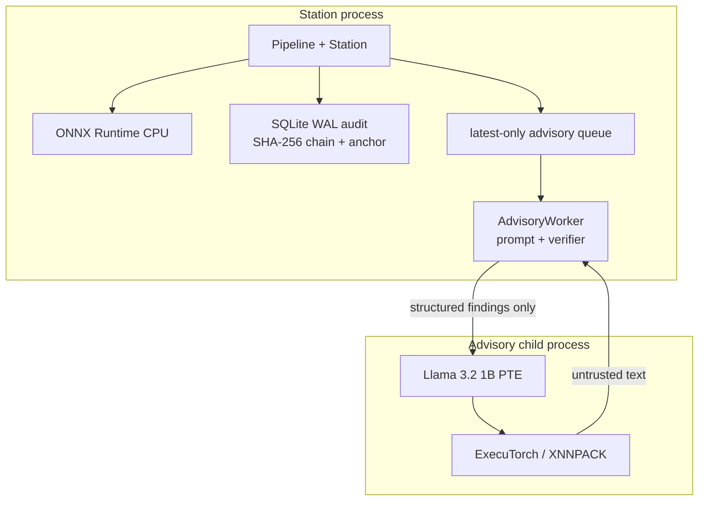
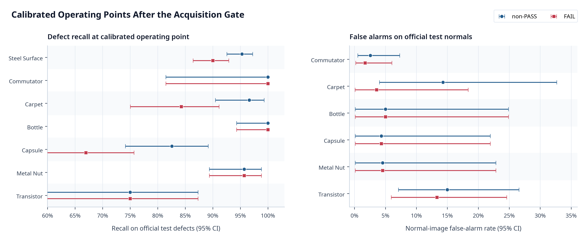
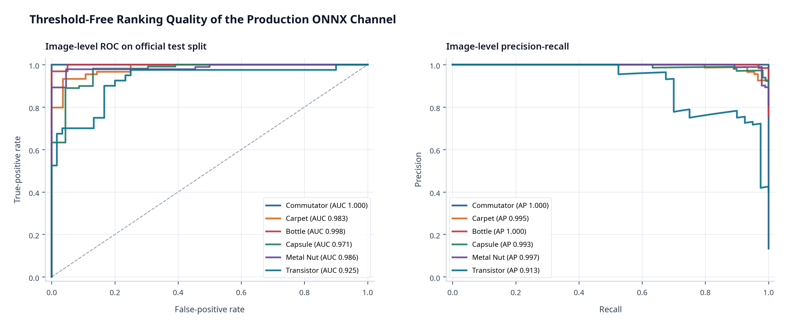
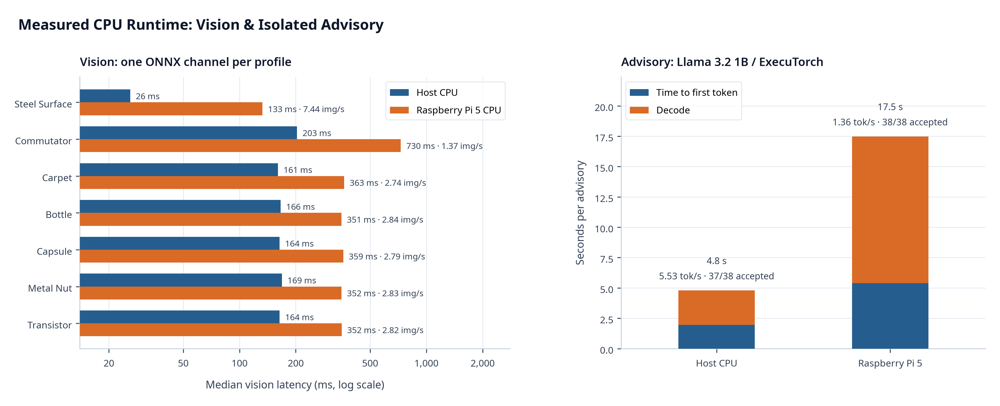

# VeriQC

**Empirically calibrated, on-device visual inspection with a verified Llama advisory.**

VeriQC inspects a manufactured part and returns `PASS`, `REVIEW` or `FAIL` with a
localised finding, an ordinal severity and a tamper-evident audit record. Vision
runs on **ONNX Runtime CPU**; the advisory is **Llama 3.2 1B Instruct** under
**ExecuTorch** in an isolated child process. The advisory receives structured
findings, never pixels, cannot change the verdict, and is checked by a
deterministic grounding verifier before its wording reaches the operator.

The supported deployment target is a CPU-only Raspberry Pi 5. The production
station does not require a GPU, a network connection or a cloud service.

---

## Problem and scope

Factory inspection has two different failure modes. A supervised detector
answers “is this a known defect?” but cannot recognise an unseen defect class.
A normal-only anomaly model answers “is this unlike a good part?” but cannot
name a known defect and can produce false alarms on normal variation. A single
score threshold also behaves differently across textures, cameras and defect
populations.

VeriQC treats inspection as a profile-isolated decision problem:

- one profile declares one vision channel, one calibration, one severity policy
  and one advisory card set;
- the channel is chosen for the supervision available in that domain;
- the decision is calibrated on held-out normal or development data;
- the operator sees the operating point, the localised evidence and the
  deterministic advice floor, not just a label;
- the advisory explains the finding and selects an action, but cannot overrule
  the vision decision.

The repository covers seven profiles: a steel detector, a commutator crack
segmenter and five MVTec AD anomaly profiles. NEU-DET and KolektorSDD are the
target-domain sources; the MVTec AD profiles demonstrate that the same station,
decision layer, audit path and advisory path generalise across textures,
objects and packaging.

---

## Solution overview



The vision path is synchronous and deterministic. The advisory is asynchronous:
a completed model answer replaces the template only after the verifier accepts
it. A missing, late or rejected answer leaves the template visible and never
changes the vision verdict.

---

## Key contributions

1. **Profile-isolated, task-appropriate inspection.** Each profile owns its
   model, calibration, severity policy and advisory cards. The deployed channel
   is YOLO detection, U-Net segmentation or PatchCore anomaly detection,
   selected by the available supervision rather than by a pooled model.
2. **Three-level empirical calibration.** Image-level split-conformal tails,
   region-level normal-region calibration and class-level steel report
   thresholds are explicit and recorded with the result.
3. **Measured architecture ablations.** The split-layer PatchCore design, the
   segmentation-only commutator decision and the calibrated operating points
   are supported by controlled comparisons; the rejected dual-channel rule is
   retained in the evidence.
4. **A fail-safe on-device advisory.** Llama 3.2 1B runs under ExecuTorch in a
   `spawn` child. It selects a cause and an action from code-owned SOP options
   and writes a short note; the parent verifies grounding and composes the
   final text. The deterministic template is the floor.
5. **Target-hardware evidence.** Every vision profile, the 38-case advisory,
   steady and overloaded co-resident runs, HTTP station startup, USB-camera
   capture, offline execution and host/Pi parity were measured on a Raspberry
   Pi 5 8 GB.
6. **Operational auditability.** Results carry artifact hashes, acquisition
   statistics, latency, findings and a hash-chained SQLite record with an
   external head anchor.

---

## Architecture

The runtime is deliberately split into two processes.



- `veriqc.pipeline.Pipeline` performs the acquisition gate, ONNX inference,
  calibration, severity and findings. It does not import PyTorch.
- `veriqc.station.service.Station` owns the audit store, the capture service and
  the latest-only advisory queue.
- `veriqc.advisory.process_runner.ProcessAdvisorRunner` owns the child process
  and the request pipe. The child owns the model and KV cache.
- `veriqc.advisory.guidance` builds the findings-only prompt, parses the
  selection and verifies the note.
- `veriqc.audit.AuditStore` appends verdict, advisory and operator-review events
  to an append-only SQLite WAL.

---

## End-to-end pipeline

1. **Acquire.** A USB/CSI camera, video, folder replay or uploaded image enters
   the capture path. The capture thread keeps only the newest frame.
2. **Gate.** `assess_quality` checks resolution, pixel count, blur ratio and
   clipping. A failed gate returns `REVIEW` before any model runs.
3. **Infer.** The profile's single ONNX channel runs on CPU: YOLO, U-Net or the
   split-layer PatchCore backbone plus its two coreset banks.
4. **Decide.** The image score is mapped to a calibrated `PASS`/`REVIEW`/`FAIL`
   operating point. A missing or non-finite channel fails closed to `REVIEW`.
5. **Localise and grade.** Findings carry a box, class, confidence, relative
   area, zone and code-owned severity. Model-driven non-`PASS` results carry at
   least one localised finding.
6. **Record.** The canonical result is appended to the audit chain with artifact
   hashes, acquisition statistics and latency.
7. **Advise.** The deterministic SOP template is produced immediately. If the
   advisory runtime is available, a child process receives compact structured
   findings and a small numbered cause/action list.
8. **Verify.** The model returns one compact line. The parent verifies the note
   against the finding, inserts the code-owned cause and action, and publishes
   the result. Rejected, late or stale output leaves the template.
9. **Review.** The operator can confirm a label, open the overlay, inspect
   history and export the audit CSV.

---

## Design decisions

| Decision | Alternative | Evidence and consequence |
|---|---|---|
| One calibrated channel per profile | Pooled model or dual known + anomaly | The Kolektor dual rule added false alarms without recall; the anomaly channel is kept for normal-only profiles. |
| Split-layer PatchCore | Single layer or full ResNet-18 | `layer2` gives the best image score; `layer3` gives near-best localisation; `layer4` is never executed. |
| Segmentation-only commutator | Segmentation + anomaly | Anomaly-only recall was 0.056; the dual rule raised false alarms from 1.71% to 2.56% without adding recall. |
| Image, region and class thresholds | One fixed threshold | Calibration cut commutator FAIL false alarms from 10.26% to 1.71% and carpet from 7.14% to 3.57%. |
| Fail closed to `REVIEW` | Substitute a weaker channel | A missing or non-finite channel must not produce a false `PASS`. |
| Findings-only advisory in a child | Free-form image advice in-process | Pixels invite invented observations; a native fault must not stop inspection. |
| Deterministic template floor | Model output directly to the operator | Rejected, late or stale model output cannot hide the code-owned advice. |
| Portrait 384x1024 Kolektor input | Landscape 1024x384 | The source is 500x1260 portrait; portrait reduced fold-0 FAIL false alarms from 3.42% to 1.71%. |

---

## Profiles and data

| Profile | Source | Domain | Task | Runtime model |
|---|---|---|---|---|
| `steel_surface` | NEU-DET | steel | 6-class detection | YOLO26n, 640 px |
| `commutator` | KolektorSDD | automotive | crack segmentation | ResNet-18 U-Net, 384x1024 |
| `textile_carpet` | MVTec AD carpet | textile | anomaly | PatchCore, 448 px |
| `packaging_bottle` | MVTec AD bottle | packaging | anomaly | PatchCore, 448 px |
| `pharma_capsule` | MVTec AD capsule | pharmaceutical | anomaly | PatchCore, 448 px |
| `automotive_metal_nut` | MVTec AD metal_nut | automotive | anomaly | PatchCore, 448 px |
| `electronics_transistor` | MVTec AD transistor | electronics | anomaly | PatchCore, 448 px |

Place the source datasets at:

```text
data/neu/NEU-DET/
data/kolektor/
data/mvtec/
```

`scripts/prepare_data.py` creates deterministic YOLO folders and split
manifests under `data/prepared/`. The official test splits are held out from
fitting and calibration. The Kolektor folds are the official JIM-2019
physical-part folds; one 15% physical-part holdout supplies both early stopping
and calibration scores, a disclosed selection limitation. The steel
development split is also used for early stopping and threshold selection.

The five MVTec AD profiles are analog sources; the steel and commutator
profiles are the target-domain evaluations. NEU-DET contains defect images
only, so the steel profile is a recall-targeted screening task.

---

## Installation

Python 3.10+ is required. The recorded host uses Python 3.12.16, PyTorch
2.15.0+cu134, ONNX Runtime 1.31.1 and ExecuTorch 1.6.0.

```bash
python -m venv venv
./venv/bin/pip install -e '.[advisory,research]'
```

Training, calibration and export additionally need the training stack:

```bash
./venv/bin/pip install -e '.[train,research]'
```

On a Raspberry Pi 5, the runtime station needs the CPU ONNX Runtime wheel, the
advisory extra and the benchmark tools:

```bash
python3 -m venv ~/veriqc-venv
~/veriqc-venv/bin/pip install -e '.[advisory,benchmark]'
# Optional CSI camera support:
~/veriqc-venv/bin/pip install -e '.[csi]'
```

The optional CPU-only PyTorch wheel is only needed for export parity or the
training/reference path:

```bash
~/veriqc-venv/bin/pip install --index-url https://download.pytorch.org/whl/cpu \
  torch==2.15.0 torchvision==0.29.2
```

The ONNX Runtime ARM64 wheel must match the Pi's Python version. The measured
Pi environment is recorded in `reports/tables/pi_vision_commutator.json`.

The repository tracks the vision exports, tokenizer, manifests and training
checkpoints under `models/`. The advisory PTE is
`models/advisory/llama32_1b_int8.pte`; the station verifies the PTE,
`tokenizer.json` and every tokenizer file against
`models/advisory/manifest.json`, and records the bundle hash in each result.
The chat template lives in `tokenizer_config.json`; copy the complete
`models/advisory/tokenizer/` directory rather than only `tokenizer.json`.

```bash
./venv/bin/python scripts/prepare_data.py all
./venv/bin/python scripts/export_onnx.py --profile all
./venv/bin/python scripts/verify_exports.py --profile all
./venv/bin/python scripts/freeze_artifacts.py
```

`scripts/freeze_artifacts.py` writes `configs/artifacts.json`. A profile is
accepted only when every runtime artifact matches its recorded SHA-256; the
station refuses a missing or modified artifact rather than silently running a
different model.

---

## Configuration

A profile YAML under `configs/profiles/` declares the source, task, one vision
channel, calibration, severity policy, advisory cards and acquisition thresholds.
The production runtime always selects ONNX Runtime CPU.

| File | Purpose |
|---|---|
| `configs/profiles/*.yaml` | One inspection problem per profile |
| `configs/calibration/*.json` | Image, region and class thresholds plus sample sizes |
| `configs/severity/*.yaml` | Area bands, class risk and zone criticality |
| `configs/cards/*.yaml` | Code-owned SOP options and escalation text |
| `configs/artifacts.json` | Frozen SHA-256 for every runtime artifact |

Relevant environment variables:

```text
VERIQC_PROFILE              default profile (commutator)
VERIQC_THREADS              ONNX Runtime intra-op threads
VERIQC_API_TOKEN            required for a non-loopback bind
VERIQC_ADVISORY_DEADLINE_S  generation deadline, default 45 s
VERIQC_OVERLAY_KEEP         retained overlay images, default 500
VERIQC_HOST / VERIQC_PORT   station bind address
VERIQC_DISABLE_ADVISORY=1   vision-only development
```

---

## Running the station

```bash
VERIQC_PROFILE=commutator ./venv/bin/python scripts/run_station.py --port 8080
```

Replay a folder or open a USB camera immediately:

```bash
VERIQC_PROFILE=commutator ./venv/bin/python scripts/run_station.py \
  --source folder --source-path data/kolektor/kos02 --interval 0.5

VERIQC_PROFILE=commutator ./venv/bin/python scripts/run_station.py \
  --source camera --source-path 0
```

Open `http://127.0.0.1:8080/`. The dashboard shows the live preview, verdict,
overlay, findings, severity, advisory, audit history and chain status. Camera
frames pass through the same acquisition gate; a blurry or undersized frame is
`REVIEW` before the model runs.

The station exposes `/health`, `/profiles`, `/profiles/{id}/activate`,
`/source/start`, `/source/stop`, `/source/status`, `/capture`, `/stream.mjpg`,
`/inspect`, `/result/{id}`, `/overlay/{id}`, `/review/{id}`, `/history`,
`/metrics`, `/export.csv` and `/ws`. The audit log is SQLite WAL with a SHA-256
chain and an external head anchor.

Set `VERIQC_API_TOKEN` before binding beyond loopback. The launcher refuses a
non-loopback bind without a token.

---

## Training and calibration

The training recipe uses YOLO26n at 640 px, COCO-initialised from
`models/weights/yolo26n.pt`, for 80 epochs with seed 20261121. The official
NEU-DET validation split is the reported test set.

```bash
./venv/bin/python scripts/train_detector.py --epochs 80 --imgsz 640 --device 0
```

The segmenter is a ResNet-18 U-Net trained at 384x1024 portrait for 30 epochs
per Kolektor fold:

```bash
./venv/bin/python scripts/train_segmenter.py --fold -1 --epochs 30 --device cuda
```

PatchCore profiles are fitted on normal training images, with a disjoint 20%
calibration split:

```bash
./venv/bin/python scripts/fit_anomaly.py mvtec \
  --categories carpet bottle capsule metal_nut transistor --device cuda
./venv/bin/python scripts/fit_anomaly.py kolektor --folds 0 1 2 --device cuda
```

Calibration and export:

```bash
./venv/bin/python scripts/calibrate.py --profile all --device cuda
./venv/bin/python scripts/export_onnx.py --profile all
./venv/bin/python scripts/verify_exports.py --profile all
./venv/bin/python scripts/freeze_artifacts.py
```

Anomaly profiles use split-conformal tail p-values on a disjoint 20% of
`train/good`, with `alpha_fail = 0.05` and `alpha_review = 0.10`. The steel
profile has a defect-only development population, so it uses a recall-targeted
screening rule: FAIL is the 10th percentile of development scores; REVIEW is the
highest lower threshold that keeps non-PASS recall at or above 95% with a review
rate at or below 10%.

---

## Evaluation and measurement

```bash
./venv/bin/python scripts/evaluate.py --profile commutator --dump-scores
./venv/bin/python scripts/evaluate.py --profile steel_surface --dump-scores
./venv/bin/python scripts/evaluate_segmenter.py --device cuda
./venv/bin/python scripts/measure.py --profile commutator --threads 4
./venv/bin/python scripts/audit_advisory.py --cases 10
./venv/bin/python scripts/offline_check.py --profile commutator
./venv/bin/python scripts/build_results_index.py
./venv/bin/python scripts/plot_results.py
```

Pi measurements:

```bash
~/veriqc-venv/bin/python scripts/benchmark_pi.py --mode vision --profile commutator
~/veriqc-venv/bin/python scripts/benchmark_pi.py --mode advisory --advisory-cases 10
~/veriqc-venv/bin/python scripts/benchmark_pi.py --mode resident \
  --images 10 --interval 45 --out reports/tables/pi_resident_steady.json
~/veriqc-venv/bin/python scripts/station_smoke.py --profile commutator \
  --out reports/tables/pi_station_smoke.json
~/veriqc-venv/bin/python scripts/station_smoke.py --profile textile_carpet \
  --camera 0 --camera-width 640 --camera-height 480 \
  --out reports/tables/pi_camera_smoke.json
~/veriqc-venv/bin/python scripts/offline_check.py --profile commutator \
  --out reports/tables/pi_offline_check.json
```

Evaluation applies the same acquisition gate as the station. A failed gate
returns `REVIEW` before either model runs. The evaluators report mAP for
detection, image/pixel AUROC, pixel AP and AU-PRO for anomaly and segmentation,
and the calibrated operating point with explicit confusion counts.

---

## Results

### Operating points

| Profile | Metric | Operating point |
|---|---|---|
| `steel_surface` | mAP50 0.760; mAP50-95 0.409 | 343/360 non-PASS (95.3%), 324/360 FAIL (90.0%), 19 REVIEW |
| `commutator` | 3-fold image AUROC 0.982; pixel AUROC 0.953; pixel AP 0.781 | 18/18 defects; FAIL false alarms 2/117 (1.71%); non-PASS 3/117 (2.56%); 1/135 REVIEW |
| `textile_carpet` | image AUROC 0.983; AU-PRO 0.907 | non-PASS recall 86/89 (96.6%); FAIL false alarms 1/28 (3.57%); non-PASS 4/28 (14.3%) |
| `packaging_bottle` | image AUROC 0.998; AU-PRO 0.910 | recall 63/63 (100%); FAIL false alarms 1/20 (5.0%) |
| `pharma_capsule` | image AUROC 0.971; AU-PRO 0.879 | non-PASS recall 90/109 (82.6%); FAIL false alarms 1/23 (4.35%) |
| `automotive_metal_nut` | image AUROC 0.986; AU-PRO 0.886 | non-PASS recall 89/93 (95.7%); FAIL false alarms 1/22 (4.55%) |
| `electronics_transistor` | image AUROC 0.925; AU-PRO 0.716 | non-PASS recall 30/40 (75.0%); FAIL false alarms 8/60 (13.3%) |



*Defect recall and normal false alarms after the acquisition gate. Error bars are
exact 95% Clopper–Pearson intervals. Steel has no normal population, so no
false-alarm rate is plotted.*



*Threshold-free image-level ranking on the production ONNX score. The curves are
computed from `reports/tables/scores/`; they are not used to choose the
operating threshold.*

### Host runtime

| Profile | Median | p95 | p99 | Peak RSS |
|---|---:|---:|---:|---:|
| `steel_surface` | 26.1 ms | 27.4 ms | 28.1 ms | 204 MB |
| `commutator` | 203.2 ms | 207.6 ms | 210.8 ms | 407 MB |
| `textile_carpet` | 160.8 ms | 219.4 ms | 228.2 ms | 282 MB |
| `packaging_bottle` | 166.2 ms | 218.4 ms | 243.1 ms | 304 MB |
| `pharma_capsule` | 163.8 ms | 219.0 ms | 239.7 ms | 293 MB |
| `automotive_metal_nut` | 168.8 ms | 230.6 ms | 241.8 ms | 282 MB |
| `electronics_transistor` | 164.0 ms | 201.6 ms | 240.2 ms | 282 MB |

Measured with four CPU threads after warmup; the station vision path excludes
upload, overlay rendering, audit writes and the asynchronous advisory.

### Raspberry Pi 5

Pi 5 Model B Rev 1.1, 8 GB RAM, Debian 13, Python 3.13.5, ONNX Runtime 1.32.0,
ExecuTorch 1.6.0, `ondemand` governor. Vision used 40 images after five warmup
images and four threads.

| Profile | Median | p95 | p99 | Throughput | Peak RSS | Max temp |
|---|---:|---:|---:|---:|---:|---:|
| `steel_surface` | 132.8 ms | 139.4 ms | 145.7 ms | 7.44 img/s | 203 MB | 50.7 °C |
| `commutator` | 729.6 ms | 735.0 ms | 738.4 ms | 1.37 img/s | 479 MB | 64.5 °C |
| `textile_carpet` | 363.2 ms | 377.2 ms | 401.4 ms | 2.74 img/s | 424 MB | 60.0 °C |
| `packaging_bottle` | 351.0 ms | 369.2 ms | 371.3 ms | 2.84 img/s | 390 MB | 59.0 °C |
| `pharma_capsule` | 358.9 ms | 374.5 ms | 378.2 ms | 2.79 img/s | 426 MB | 58.4 °C |
| `automotive_metal_nut` | 351.6 ms | 364.8 ms | 378.1 ms | 2.83 img/s | 339 MB | 59.5 °C |
| `electronics_transistor` | 352.1 ms | 381.2 ms | 386.2 ms | 2.82 img/s | 416 MB | 59.5 °C |

No vision run recorded a throttle flag. The PMIC core rail stayed below 7.5 W.



*Host and Pi vision medians, and the 38-case advisory latency on both devices.
The advisory is asynchronous and does not sit on the inspection critical path.*

### Advisory

| Metric | Host | Raspberry Pi 5 |
|---|---:|---:|
| Cases | 38 | 38 |
| Accepted | 37 (0.974) | 38 (1.000) |
| Format rejects | 1 | 0 |
| Generation timeouts | 0 | 0 |
| Accepted grounding violations | 0 | 0 |
| Median latency | 4.79 s | 17.48 s |
| Median TTFT | 1.95 s | 5.40 s |
| Median decode | 5.53 tok/s | 1.36 tok/s |
| Resident memory | 2.74 GB | 2.37 GB child / 2.81 GB tree |

The co-resident steady run delivered one defective part every 45 s: 10/10
inspections returned `FAIL`, 10/10 advisories were accepted, vision median was
750 ms, queue depth stayed at 1, and there were no drops or timeouts. The stress
run submitted 96 defects at 2 s spacing: all 96 returned `FAIL`, vision median
was 1.58 s under four-core contention, 8 model answers completed and 88 stale
items received the deterministic template; the queue drained in 33.5 s and the
audit chain stayed valid. No run recorded a throttle flag.

### Parity, offline and camera checks

- ONNX-vs-PyTorch parity on the host: segmenter maximum logit difference
  `< 8.1e-6`, anomaly backbone maximum feature difference `< 3.7e-6`, detector
  maximum box difference `< 8.7e-4 px` and confidence difference `< 1.6e-6` on
  eight test images. The detector comparison uses the production
  `ONNXDetector` decoder.
- The full 135-image commutator evaluation on the Pi reproduced the host
  operating point exactly: `PASS=114`, `REVIEW=1`, `FAIL=20`, 18/18 defects,
  3 non-PASS false alarms and 2 FAIL false alarms. Pixel AUROC 0.9500, AU-PRO
  0.8879 and pixel AP 0.8047 on both the host ONNX and Pi ONNX paths; the
  PyTorch fold-0 reference is 0.8048. Pi vision median was 701.3 ms.
- Station health was 17.5 s to HTTP with the advisory PTE; the
  first advisory over HTTP was accepted in 17.6 s. Overlay, CSV export and the
  audit chain passed.
- A live USB-camera check captured a 640x480 frame, passed the `textile_carpet`
  acquisition gate (blur ratio 0.041), ran the ONNX anomaly path in 322.3 ms,
  returned an accepted advisory in 17.6 s, and served overlay and CSV with
  HTTP 200 and a valid audit chain.
- A socket-blocked inspection and dashboard asset check passed on the host and
  the Pi.

---

## Reproducibility

- All splits are deterministic and written to `data/prepared/*/manifest.json`.
- Every profile records model, calibration, severity, card and runtime artifact
  hashes in `configs/artifacts.json`; the station refuses a mismatch.
- Every result records the profile, artifact hashes, backend, device, latency,
  acquisition statistics and, when enabled, the advisory hash bundle.
- ONNX exports are parity-checked against the PyTorch reference before they are
  frozen. The production station never imports PyTorch.
- `reports/results.json` is generated from checked-in tables; it is the
  machine-readable source of truth for the reported numbers.
- `reports/tables/scores/*.json` contains the per-image scores used for the ROC
  and precision-recall figures, so the curves can be regenerated without
  re-running a model.

The segmenter preprocessing and protocol arms were compared on the official test
split during development; the selected arm is a development choice rather than a
pristine one-shot holdout. The steel and Kolektor calibration/early-stopping
splits overlap; the pre-fix steel operating point is retained in
`reports/tables/archive/`.

---

## Repository structure

```text
veriqc/
  pipeline.py              ONNX inspection: gate, model, calibration, findings
  inspection.py            canonical result and finding schema
  calibration.py           image/region conformal calibration
  decision.py              fail-closed PASS/REVIEW/FAIL rules
  severity.py              area x class x zone policy
  quality.py               acquisition gate
  rendering.py             overlay rendering and retention
  audit.py                 SQLite WAL hash chain and anchor
  models/
    onnx_runtime.py        production ONNX detector/segmenter/PatchCore
    torch_detector.py      training and export reference
    torch_segmenter.py     training and export reference
    torch_patchcore.py     training and export reference
  advisory/
    process_runner.py      isolated child lifecycle and timeout
    executorch.py          ExecuTorch Llama runtime
    guidance.py            prompt, parser, verifier, composer
    worker.py              template floor and advisory outcome
  station/
    app.py                 FastAPI endpoints
    service.py             station orchestration and queue
    capture.py             latest-frame capture
    sources.py             camera, video and folder sources
    dashboard.html         operator UI
configs/
  profiles/                one YAML per inspection problem
  calibration/             fitted image, region and class thresholds
  severity/                severity policy per profile
  cards/                   advisory SOP cards
  artifacts.json           frozen runtime hashes
scripts/                   data, training, calibration, export, evidence
experiments/               layer, channel and calibration ablations
tests/                     unit, parity, station and repository contracts
reports/
  results.json             machine-readable evidence index
  tables/                  measured tables and per-image scores
  models/                  export and advisory manifests
  figures/                 generated publication figures
  tables/archive/          retained pre-fix and pre-refactor evidence
models/                    runtime exports, tokenizer, manifests, checkpoints
```

---

## Limitations

- **Steel is a screening profile.** NEU-DET contains defect images only, so the
  reported steel numbers are recall and review counts, not normal-steel false
  alarms. The review band is reachable and model-triggered; five of the 19
  steel reviews are acquisition-gate rejections and fourteen are model-band
  decisions.
- **Severity is an application policy, not a physical measurement.** It uses
  relative area, defect class and zone; no millimetre or tolerance claim is made
  without camera calibration.
- **Region tail scores are contextual.** The stored region value is an empirical
  conditional tail score fitted on normal regions; it supports localisation
  review but is not used for the verdict and is not a family-wise significance
  test.

---

## References and licence

The research record, including the protocols and ablations, is in
[`RESEARCH.md`](RESEARCH.md).

Key references:

1. K. Song and Y. Yan, “A noise robust method based on completed local binary
   patterns for hot-rolled steel strip surface defects,” *Applied Surface
   Science*, 285:858–864, 2013.
2. D. Tabernik, S. Šela, J. Skvarč and D. Skočaj, “Segmentation-based
   deep-learning approach for surface-defect detection,” *Journal of
   Intelligent Manufacturing*, 31(3):759–776, 2020.
3. P. Bergmann, M. Fauser, D. Sattlegger and C. Steger, “MVTec AD — A
   Comprehensive Real-World Dataset for Unsupervised Anomaly Detection,”
   *CVPR*, 2019.
4. K. Roth, L. Pemula, J. Zepeda, B. Schölkopf, T. Brox and P. Gehler, “Towards
   Total Recall in Industrial Anomaly Detection,” *CVPR*, 2022.
5. K. Batzner, L. Heckler and R. König, “EfficientAD: Accurate Visual Anomaly
   Detection at Millisecond-Level Latencies,” *WACV*, 2024.
6. A. Angelopoulos and S. Bates, “A Gentle Introduction to Conformal Prediction
   and Distribution-Free Uncertainty Quantification,” arXiv:2107.07511, 2021.
7. Meta, *Llama 3.2 Community License Agreement*, 2024; ExecuTorch
   documentation; Ultralytics YOLO documentation.

The code is licensed under **AGPL-3.0-only** because the steel detector is
trained with the Ultralytics YOLO implementation. The Llama 3.2 Community
License and Acceptable Use Policy apply to the advisory materials; the required
attribution is carried in `NOTICE` and `LICENSE-LLAMA-3.2.md`. **Built with
Llama.** NEU-DET,
KolektorSDD and MVTec AD are not redistributed and retain their own terms. The
runtime artifact and export hashes are recorded in `configs/artifacts.json` and
`reports/models/`.
