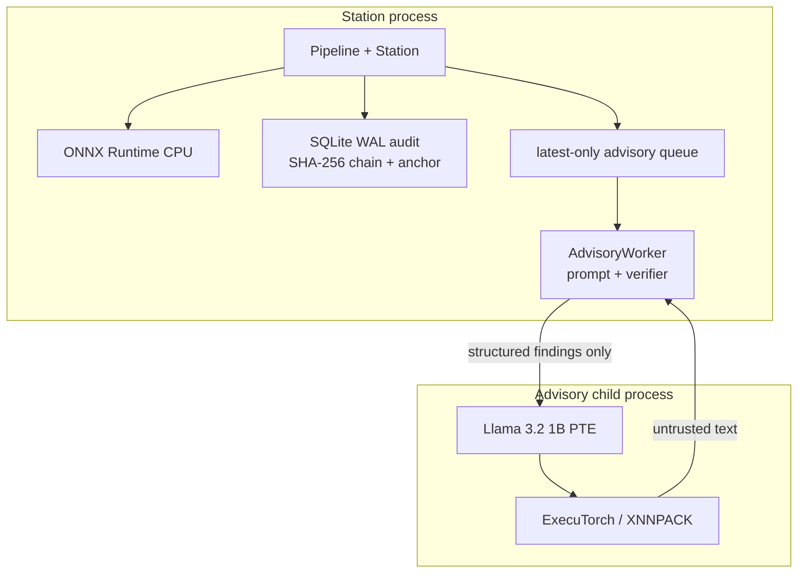
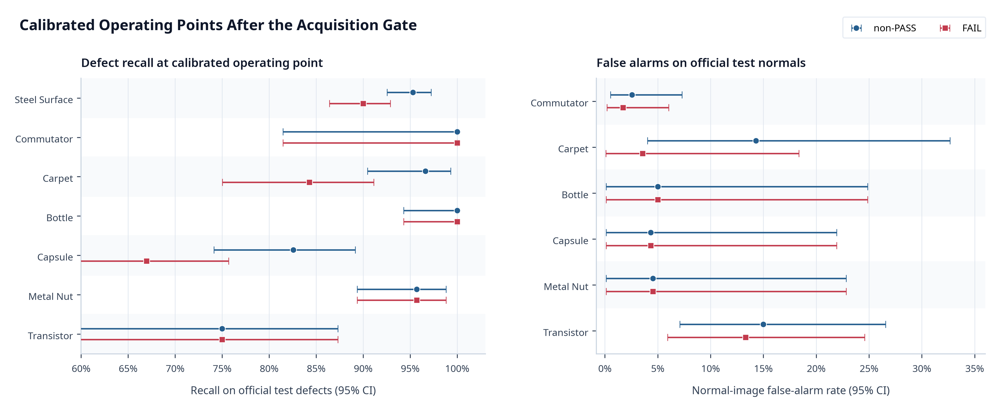
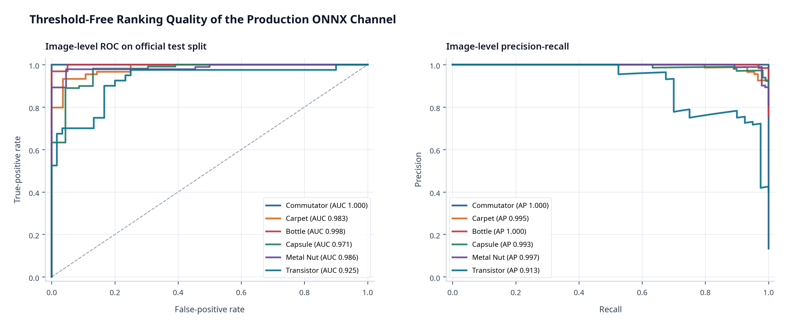
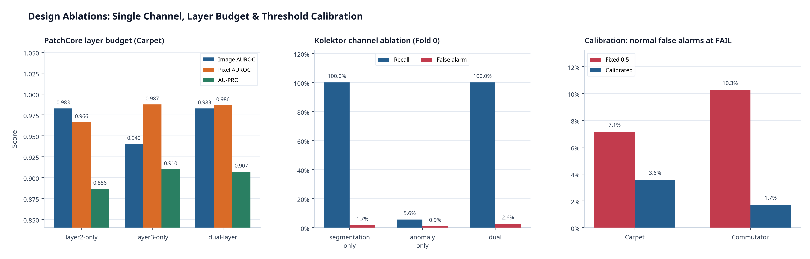
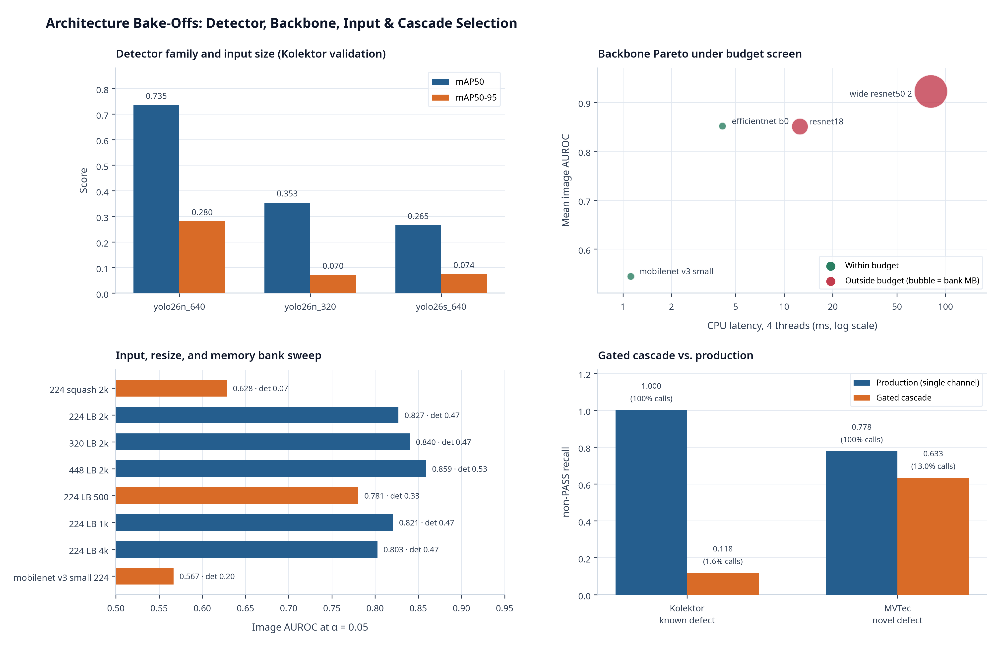

# VeriQC — Research Record

## Abstract

VeriQC is a profile-isolated edge inspection system for manufacturing quality
control. Each profile selects one task-appropriate vision channel: a YOLO
detector for known defect classes, a U-Net segmenter for thin cracks, or a
normal-only PatchCore anomaly model where defect examples are unavailable. The
selected score is converted into a calibrated `PASS`/`REVIEW`/`FAIL` operating
point, and every result carries localised findings, an ordinal severity,
acquisition statistics, artifact hashes, latency and a tamper-evident audit
entry. A Llama 3.2 1B Instruct model runs under ExecuTorch in an isolated child
process. It receives structured findings, never pixels, and can only refine a
deterministic advisory after passing a grounding verifier.

The system is evaluated on NEU-DET, KolektorSDD and five MVTec AD categories.
The Kolektor profile uses segmentation only because a measured channel ablation
showed that adding the anomaly channel increased false alarms without adding
recall. The anomaly channel is retained for the normal-only MVTec profiles,
where it is the only available supervision. A Raspberry Pi 5 8 GB ONNX Runtime
campaign reports all seven vision profiles, the 38-case compact advisory,
co-resident scheduling, HTTP station startup, USB-camera capture, offline
execution and host/Pi parity. The contribution is a calibrated, auditable
integration with measured failure modes rather than a new backbone
architecture.

## Problem and formulation

An inspection station receives an image \(x\), a profile \(p\), and a part
identifier. It must return:

\[
r = (v, F, s, a, \ell)
\]

where \(v \in \{\text{PASS}, \text{REVIEW}, \text{FAIL}\}\), \(F\) is a set of
localised findings, \(s\) is an ordinal severity, \(a\) is an operator-facing
advisory, and \(\ell\) is an audit record containing the evidence used for the
decision.

The station has five requirements:

- detect and localise defects, classify known defect types, grade severity,
  alert the operator and retain a record;
- run a Llama-family advisory on-device through ExecuTorch, with no cloud
  inference;
- support a CPU-only Raspberry Pi 5 path, measured on the target hardware;
- report latency and false-alarm behaviour at the operating point rather than
  hiding them behind a single aggregate metric;
- keep each inspection domain isolated so a threshold or model learned for one
  defect population cannot silently transfer to another.

The formulation is deliberately decision-centric. A score is not an answer; the
answer is a calibrated operating point with a stated review band, a fail-closed
behaviour when the channel is unavailable, and a record of the evidence.

## Related work and positioning

**Supervised detection and segmentation.** YOLO-style detectors regress boxes
and class scores and are effective when defect classes and annotations exist.
KolektorSDD demonstrates segmentation-based crack detection with a small
encoder-decoder. VeriQC uses these as task-appropriate channels rather than
assuming one model family fits every domain.

**Normal-only anomaly detection.** PatchCore builds a coreset memory bank from
normal patch features and scores a test image by nearest-neighbour distance.
EfficientAD targets low-latency anomaly detection with a student-teacher
design. VeriQC uses a split-layer PatchCore variant: `layer2` supplies the
image score and `layer3` supplies the localisation map, so `layer4` is never
executed. The design is a latency/localisation trade-off; the measured operating points
are reported below.

**Conformal calibration.** Split-conformal tails provide a distribution-free
empirical p-value under exchangeability. VeriQC applies the tail to the
image-level channel score, uses normal-region calibration for localisation
thresholds, and reports finite-sample order statistics. The steel profile has
no normal population, so it uses a recall-targeted screening rule instead.

**On-device language models.** ExecuTorch provides an on-device runtime for
Llama-family models. VeriQC keeps the model in a child process and treats its
text as untrusted input. The model selects a cause and an action from
code-owned SOP options and writes a short note; the parent verifies grounding
and composes the final text. The deterministic template is always available.

**Positioning.** The contribution is the combination of profile isolation,
three-level empirical calibration,
fail-closed decisions, process-isolated advisory generation and target-hardware
evidence, with the negative results retained.

## Hypothesis

A profile-isolated system that (i) selects the vision channel appropriate to the
available supervision, (ii) calibrates the decision on held-out data, (iii)
fails closed when a channel is unavailable, and (iv) constrains the advisory to
verified structured findings will produce an edge inspection station whose
operating point, latency and failure modes can be measured and audited on the
target hardware.

The hypothesis is supported if the calibrated operating points are reachable,
the host/Pi execution parity holds, the advisory remains grounded under a
bounded deadline, and the audit chain detects tampering.

## System architecture



A profile declares its source, task, one vision channel, calibration, severity
policy, advisory cards and acquisition thresholds. A profile is complete and
artifact-hashed or it fails with an explicit error; there is no fallback to
another profile. The vision and advisory runtimes are separate processes. The
advisory can fail, time out or be rejected without affecting the verdict; the
deterministic template remains visible.

The station accepts USB or CSI camera, video, folder replay and upload input. A
capture thread keeps only the newest frame; the inspection worker performs the
quality gate, vision, calibration, severity, audit write and advisory hand-off.
The dashboard exposes the live preview, result overlay, findings, severity,
advisory, audit history and station metrics.

## Vision channels

### NEU detector

The steel profile uses YOLO26n at 640 px, initialised from the COCO checkpoint
and trained for 80 epochs with seed 20261121. The official 360-image NEU-DET
validation split is the reported test set. Measured mAP50 is 0.760, mAP50-95
0.409, precision 0.703 and recall 0.705.

The acquisition gate runs before the detector. On the 360 defective test images
it sends five to `REVIEW`. The remaining model results are 324 `FAIL`, 14
`REVIEW` and 17 `PASS`, so 343/360 are non-PASS (95.3%, 95% CI 92.6–97.2%) and
324/360 are `FAIL` (90.0%, 95% CI 86.4–92.9%). The 17 misses are low-confidence
or small defects, a known limitation of a 640 px detector on 200 px source
images with coarse boxes.

The FAIL threshold is the 10th percentile of held-out defective scores; the
review threshold is the highest lower threshold that keeps non-PASS recall at or
above 95% with a review rate at or below 10%. The review band is reachable and
model-triggered.

### Kolektor segmenter

A ResNet-18 U-Net is trained at 384x1024 portrait resolution with BCE (positive
weight 10) plus Dice loss, 30 epochs per fold. Normal scans with empty masks are
included as negatives. The input geometry matches the 500x1260 source aspect
ratio; the earlier landscape 1024x384 experiment is retained as an ablation.

Three-fold results on the official test split, evaluated at 512x1408:

| Metric | Fold 0 | Fold 1 | Fold 2 | Mean |
|---|---:|---:|---:|---:|
| Image AUROC | 1.0000 | 0.9991 | 0.9459 | 0.9817 |
| Pixel AUROC | 0.9500 | 0.9907 | 0.9170 | 0.9526 |
| Pixel AP | 0.8048 | 0.7968 | 0.7423 | 0.7813 |
| AU-PRO | 0.8879 | 0.9293 | 0.7545 | 0.8572 |
| Best image F1 | 1.0000 | 0.9730 | 0.9375 | 0.9702 |

Fold 0 is the deployed profile. At its calibrated operating point it detects
18/18 defective scans, passes 114/117 normal scans and sends one scan to
`REVIEW`. FAIL false alarms are 2/117 (1.71%, 95% CI 0.21–6.04%); non-PASS false
alarms are 3/117 (2.56%, 95% CI 0.53–7.31%). The review rate is 1/135 (0.74%).
Fold 2 is the weak case and is reported transparently.

### PatchCore anomaly channel

ResNet-18 is truncated to `layer2` and `layer3`; `layer4` is never executed. The
image score uses a `layer2` coreset bank (fine texture); the heatmap uses a
`layer3` bank (more semantic). Each bank has 4,000 vectors selected by greedy
k-center from a 20,000-patch pool. Input is 448 px letterboxed; the heatmap is
mapped back to native geometry. A profile stores both banks and the backbone
state.

| Category | Image AUROC | Pixel AUROC | Pixel AP | AU-PRO |
|---|---:|---:|---:|---:|
| carpet | 0.9827 | 0.9864 | 0.6064 | 0.9070 |
| bottle | 0.9984 | 0.9838 | 0.7373 | 0.9102 |
| capsule | 0.9705 | 0.9844 | 0.3999 | 0.8790 |
| metal_nut | 0.9858 | 0.9630 | 0.7475 | 0.8863 |
| transistor | 0.9250 | 0.8487 | 0.5026 | 0.7157 |
| **mean** | **0.9725** | **0.9533** | **0.5987** | **0.8596** |

The gap to larger published PatchCore/EfficientAD-class models is the price of a
448 px, layer-truncated ResNet-18 edge model. The transistor profile is the weak
case: small, low-contrast defects and a different object scale. It is retained
rather than omitted.

## Calibration and decision

### Image-level split-conformal tails

For each enabled anomaly channel, calibration scores are collected on held-out
normal data. The p-value is

\[
p(s) = \frac{1 + \#\{s_i \ge s\}}{n_{\mathrm{cal}} + 1}.
\]

Thresholds are finite-sample order statistics. Anomaly profiles use
\(\alpha_{\mathrm{fail}} = 0.05\) and \(\alpha_{\mathrm{review}} = 0.10\). A
missing or non-finite active channel is `REVIEW`, never a silent substitute.

The threshold used for a channel score is the empirical order statistic
consistent with the requested tail. The decision rule is monotone in the score:

\[
v = \begin{cases}
\text{FAIL} & p(s) \le \alpha_{\mathrm{fail}},\\
\text{REVIEW} & \alpha_{\mathrm{fail}} < p(s) \le \alpha_{\mathrm{review}},\\
\text{PASS} & p(s) > \alpha_{\mathrm{review}}.
\end{cases}
\]

### Region calibration

The localisation threshold is fitted on normal calibration heatmaps or masks.
The measured false-region rate is recorded; findings carry a region tail score,
and an empty normal-region null yields 1.0 rather than significance. The region
tail score is an empirical conditional statistic fitted on regions above the
localisation threshold. It supports localisation review but is not used for the
image-level verdict and is not a family-wise significance test.

### Class thresholds

The steel detector uses per-class report thresholds calibrated on matched
development boxes. They control which findings and advice are shown and do not
change the image-level verdict. A non-PASS model result always carries at least
one localised finding; an acquisition-gate `REVIEW` runs no model and therefore
carries none.

### Steel screening rule

NEU-DET contains defect images only. The steel profile therefore uses a
recall-targeted screening rule rather than a normal-calibrated p-value: FAIL is
the 10th percentile of held-out defective scores, and REVIEW is the highest
threshold below FAIL that keeps non-PASS recall at or above 95% with a review
rate at or below 10%.

The earlier configuration assigned the review threshold above FAIL, making the
model review band unreachable. The correction is retained in the archive as a
before/after record.

### Rejected dual-channel rule

The channel ablation fused the segmentation and anomaly tails as

\[
p_{\mathrm{dual}} = \min(p_{\mathrm{known}}, p_{\mathrm{anomaly}})
\]

and calibrated the fused null on paired normal scans. This was a single
calibrated test, not a Bonferroni split of a small calibration set. The final
commutator profile uses segmentation only; the dual rule is retained only in the
ablation.

## Severity

Severity is code-owned:

\[
\text{score} = \text{area band} \times \text{class risk} \times \text{zone criticality}.
\]

Area bands are 0.5/1.0/2.0/3.0 for relative defect areas below the
minor/major/critical thresholds. Class risk is a profile policy (for example
crack 1.5, inclusion 1.5, scratches 1.4). Zone criticality is 1.0 centre, 1.3
edge, 1.4 corner. Confidence and anomaly p-values are not severity inputs.

The policy is an application decision, not a validated physical measurement; no
millimetre claim is made without a calibrated camera scale.

## Advisory

### Runtime isolation

Llama 3.2 1B Instruct, int8-stored linear weights and an fp32 embedding, is
exported to ExecuTorch/XNNPACK. It runs in a `spawn` child process with a
20-token generation cap and a 45 s deadline (`VERIQC_ADVISORY_DEADLINE_S`). The
parent owns the prompt, parser and verifier; the child owns the model and KV
cache.

The runner resets the model before every generation. A generation timeout or a
runtime failure terminates and restarts the child. A stale advisory is replaced
by a newer part and logged with the deterministic template; the queue holds at
most one pending item.

### Prompt and parsing

The prompt contains the profile, verdict, up to four findings (class, source,
severity, relative area, zone, confidence, region tail score), a short
recent-batch summary, and compact numbered CAUSE/ACTION options written by code
from the selected SOP card. The model is asked for one line:

```text
CAUSE:<n>|ACTION:<n>|NOTE:<max ten words, no digits>
```

The parser accepts three-line output and natural references such as
`CAUSE: handling damage`. The first complete block is evaluated; later blocks
are ignored.

### Verification and composition

The verifier rejects numerals in the note, record identifiers, unsupported
defect classes, overstated certainty, and advice that suggests bypassing
inspection. Cause and action sentences are inserted from the card by code. A
rejected or late answer leaves the deterministic template visible. The
advisory never receives pixels and cannot change the decision.

### Measured advisory behaviour

The host audit used 38 real `FAIL`/`REVIEW` findings from four profiles with the
compact prompt and the int8 PTE:

| Metric | Host | Raspberry Pi 5 |
|---|---:|---:|
| Cases | 38 | 38 |
| Accepted | 37 | 38 |
| Acceptance rate | 0.974 | 1.000 |
| Format rejects | 1 | 0 |
| Generation timeouts | 0 | 0 |
| Accepted grounding violations | 0 | 0 |
| Median end-to-end latency | 4,789 ms | 17,476 ms |
| Median TTFT | 1,945 ms | 5,402 ms |
| Median decode rate | 5.53 tok/s | 1.36 tok/s |
| Resident memory | 2,741 MB | 2,374 MB child / 2,806 MB tree |

The host case set contains the first ten defect images per profile; the Pi
campaign uses the same construction. The acceptance rate measures format,
grounding and runtime success on those findings. The Pi latency includes the
child model and the parent-side round trip, not vision.

## Data and protocols

| Profile | Source | Split | Task |
|---|---|---|---|
| `steel_surface` | NEU-DET | official 1,440 train (1,439 usable) / 360 validation; 90/10 train/dev by image | 6-class detection |
| `commutator` | KolektorSDD | official JIM-2019 3-fold by physical part | crack segmentation |
| `textile_carpet` | MVTec AD carpet | official train/test; 80/20 fit/cal of train/good | anomaly |
| `packaging_bottle` | MVTec AD bottle | same | anomaly |
| `pharma_capsule` | MVTec AD capsule | same | anomaly |
| `automotive_metal_nut` | MVTec AD metal_nut | same | anomaly |
| `electronics_transistor` | MVTec AD transistor | same | anomaly |

Kolektor has 399 scans from 50 physical parts: 52 defective and 347 normal. Every
part has at least one defective scan, so the scan is the risk unit. A 15%
physical-part holdout supplies both early-stopping and calibration scores; the
shared holdout is a disclosed selection limitation.

MVTec calibration uses a disjoint 20% of `train/good`; the official test set is
used for reporting. No test image is used for fitting or threshold selection.
The five MVTec profiles are analog sources, not factory claims.

The official test splits are the reported test sets. The segmenter preprocessing
and protocol arms were compared on the official test split during development,
so the selected arm is a development choice rather than a pristine one-shot
holdout. The steel review-band correction was made after the first evaluation
pass and is retained with its pre-fix record.

## Training and export

- **Detector:** YOLO26n, 640 px, COCO initialisation from
  `models/weights/yolo26n.pt`, 80 epochs, seed 20261121. The training script
  records the initial checkpoint and output hashes.
- **Segmenter:** ResNet-18 U-Net, 384x1024, BCE with positive weight 10 plus
  Dice loss, 30 epochs per fold, seed 20261121 + fold. Normal scans are included
  as negatives. The recorded fold training budgets were:

  | Fold | Train images | Val images | Best epoch | Best val loss | Train s |
  |---|---:|---:|---:|---:|---:|
  | 0 | 224 | 40 | 30 | 1.1263 | 224.9 |
  | 1 | 224 | 39 | 25 | 1.1543 | 225.9 |
  | 2 | 231 | 40 | 24 | 1.1625 | 232.6 |

  The validation split also supplies calibration scores for the current
  protocol; this shared role is stated in the protocol and ablation sections.
- **PatchCore:** ResNet-18 `layer2`/`layer3`, 448 px, 4,000-vector banks from a
  20,000-patch coreset. Fitted on normal training images only.
- **Export:** ONNX opset 17 with static input geometry. The detector uses the
  Ultralytics ONNX export; the segmenter and anomaly backbone use
  `torch.onnx.export`.
- **Parity:** the production ONNX wrappers are compared with the PyTorch
  reference on real images and random tensors before the artifacts are frozen.

The production station loads ONNX only. PyTorch remains the training,
calibration, export and parity reference; the runtime module does not import
`torch` or `ultralytics`.

## Experimental protocol

- **Detection:** official NEU-DET validation split; mAP50, mAP50-95, precision
  and recall; then the calibrated operating point after the acquisition gate.
- **Segmentation:** official Kolektor test fold; image AUROC, pixel AUROC, pixel
  AP, AU-PRO and best image F1; then fold-0 operating point.
- **Anomaly:** official MVTec test split; image AUROC, pixel AUROC, pixel AP and
  AU-PRO; then the calibrated operating point on the same split.
- **Runtime:** host ONNX station path with four threads; Pi ONNX vision with 40
  images after five warmups and four threads. Temperature, throttle flags and
  the PMIC core rail are sampled once a second on the Pi.
- **Advisory:** 38 real findings from four profiles; acceptance, format rejects,
  grounding violations, end-to-end latency, TTFT, decode rate and memory.
- **Co-resident:** one defective part every 45 s for ten parts, then 96 defects
  at 2 s spacing to expose the latest-only queue capacity boundary.
- **Acceptance:** HTTP station startup, overlay and CSV endpoints, audit chain,
  USB-camera capture and a socket-blocked inspection.

## Results

### Operating points

Rates are on the official test split after the profile acquisition gate.
“Non-PASS” counts `REVIEW` and `FAIL` as detected; “FAIL” counts only `FAIL`.

| Profile | Defect recall (non-PASS) | Defect recall (FAIL) | Normal false alarm (non-PASS) | Normal false alarm (FAIL) | REVIEW rate |
|---|---:|---:|---:|---:|---:|
| `steel_surface` | 0.9528 | 0.9000 | — | — | 0.0528 |
| `commutator` | 1.0000 | 1.0000 | 0.0256 | 0.0171 | 0.0074 |
| `textile_carpet` | 0.9663 | 0.8427 | 0.1429 | 0.0357 | 0.1197 |
| `packaging_bottle` | 1.0000 | 1.0000 | 0.0500 | 0.0500 | 0.0000 |
| `pharma_capsule` | 0.8257 | 0.6697 | 0.0435 | 0.0435 | 0.1288 |
| `automotive_metal_nut` | 0.9570 | 0.9570 | 0.0455 | 0.0455 | 0.0000 |
| `electronics_transistor` | 0.7500 | 0.7500 | 0.1500 | 0.1333 | 0.0100 |

Exact 95% Clopper–Pearson intervals are in `reports/results.json`. Key
intervals: Kolektor defect recall 18/18 (0.815–1.000), Kolektor FAIL false
alarms 2/117 (0.002–0.060), steel non-PASS recall 343/360 (0.926–0.972), steel
FAIL recall 324/360 (0.864–0.929). Of the 19 steel `REVIEW` results, five are
acquisition-gate rejections and fourteen are model review-band decisions.



*Defect recall and normal false alarms after the acquisition gate. Error bars are
exact 95% Clopper–Pearson intervals.*



*Threshold-free image-level ranking from the production ONNX score. The curves
are not used to choose the operating threshold.*

### Host and Pi execution parity

The full 135-image commutator evaluation produced identical counts on the host
ONNX path and the Pi ONNX path: `PASS=114`, `REVIEW=1`, `FAIL=20`, 18/18
defects, 3 non-PASS false alarms and 2 FAIL false alarms. Pixel AUROC was
0.9500, AU-PRO 0.8879 and pixel AP 0.8047 on both paths; the PyTorch fold-0
reference is 0.8048. Pi vision median was 701.33 ms. This is an execution-parity
check, not a second independent test population.

ONNX-vs-PyTorch parity on the host: segmenter maximum logit difference
\(8.0\times10^{-6}\), anomaly backbone maximum feature difference
\(3.6\times10^{-6}\), detector maximum box difference
\(8.7\times10^{-4}\) px and confidence difference \(1.5\times10^{-6}\) on eight
test images. The detector comparison uses the production `ONNXDetector`
letterbox/NMS decoder.

### Advisory

The host accepted 37/38 cases with one format reject and no generation timeout;
the Pi accepted 38/38. No accepted answer carried a grounding violation. The Pi
median was 17.48 s with a 5.40 s TTFT and 1.36 tok/s. The co-resident steady run
delivered 10/10 accepted advisories at a 750 ms vision median. The stress run
submitted 96 defects at 2 s spacing: all 96 returned `FAIL`, vision median was
1.58 s under four-core contention, 8 model answers completed, 88 stale items
received the deterministic template, and the queue drained in 33.5 s. The audit
chain stayed valid; no run recorded a throttle flag.

### Station and camera acceptance

Station health was 17.5 s to HTTP with the advisory PTE; the first advisory over
HTTP was accepted in 17.6 s. Overlay and CSV endpoints returned HTTP 200 and the
chain verified. A live USB-camera check captured a 640x480 frame, passed the
`textile_carpet` acquisition gate (blur ratio 0.041), ran the ONNX anomaly path
in 322.3 ms, returned an accepted advisory in 17.6 s, and served overlay and CSV
with a valid audit chain. A socket-blocked inspection and dashboard asset check
passed on the host and the Pi.

## Ablations

### Layer budget

| Arm | Image AUROC | Pixel AUROC | AU-PRO |
|---|---:|---:|---:|
| layer2 only | 0.9827 | 0.9661 | 0.8865 |
| layer3 only | 0.9402 | 0.9874 | 0.9098 |
| dual (layer2 image, layer3 map) | 0.9827 | 0.9864 | 0.9070 |

The dual arm keeps the best image score and nearly the best localisation
without executing `layer4`. This justifies the split-layer design.

### Channel contribution

| Arm | Recall | False-alarm rate |
|---|---:|---:|
| segmentation only | 1.0000 | 0.0171 |
| anomaly only | 0.0556 | 0.0085 |
| dual | 1.0000 | 0.0256 |

The anomaly channel did not add recall on this thin-crack dataset and increased
the false-alarm rate. The final commutator profile therefore uses segmentation
only. The anomaly-only image AUROC was 0.9492/0.8743/0.8878 across folds, but its
pixel AP was only 0.077/0.088/0.100; the channel is not competitive for this
defect.

### Calibration

| Profile | Fixed recall | Fixed FPR | Calibrated recall | Calibrated FPR |
|---|---:|---:|---:|---:|
| carpet (anomaly) | 0.9326 | 0.0714 | 0.8427 | 0.0357 |
| commutator (segmentation) | 1.0000 | 0.1026 | 1.0000 | 0.0171 |

The MVTec test false-alarm rates at the FAIL line are 3.6% (carpet), 5.0%
(bottle), 4.3% (capsule), 4.5% (metal_nut) and 13.3% (transistor). The review
band absorbs additional uncertainty and is reported rather than suppressed.

### Segmenter geometry and split protocol

| Arm | Input | Split | Image AUROC | Pixel AUROC | Pixel AP | AU-PRO |
|---|---|---|---:|---:|---:|---:|
| landscape-current | 1024x384 | 28 train / 5 val | 0.9977 | 0.9533 | 0.7261 | 0.8510 |
| portrait-current (selected) | 384x1024 | 28 train / 5 val | 0.9817 | 0.9526 | 0.7813 | 0.8572 |
| landscape-nested | 1024x384 | 23 / 5 / 5 | 0.9968 | 0.9334 | 0.6541 | 0.8071 |
| portrait-fixed (folds 1–2) | 384x1024 | 28 / 0 / 5 | 0.9994 | 0.9233 | 0.6668 | 0.8196 |
| portrait-nested (fold 0) | 384x1024 | 23 / 5 / 5 | 1.0000 | 0.9698 | 0.8089 | 0.9068 |

Portrait-current is selected because the deployed fold-0 operating point is
better: recall remains 1.000, FAIL false alarms fall from 3.42% to 1.71%,
non-PASS false alarms from 9.4% to 2.56%, and review from 5.19% to 0.74%. The
three-fold image AUROC is lower because fold 2 is weaker (0.9459); that result
is retained. The landscape-nested and portrait-fixed protocols remove the
shared calibration/early-stopping split but cost 0.07–0.12 pixel AP. The
portrait-nested fold-0 arm is stronger (pixel AP 0.8089, AU-PRO 0.9068); it is
a fold-0 result, while the three-fold table reports the arms trained across all
folds.

Fold-0 operating points for the two deployed-candidate geometries:

| Arm | Recall non-PASS | Recall FAIL | FPR non-PASS | FPR FAIL | Review rate |
|---|---:|---:|---:|---:|---:|
| landscape-current | 1.0000 | 1.0000 | 0.0940 | 0.0342 | 0.0519 |
| portrait-current (selected) | 1.0000 | 1.0000 | 0.0256 | 0.0171 | 0.0074 |

### Kolektor anomaly-only arms

The anomaly-only channel was also fitted on each Kolektor fold to test whether
a normal-only model could replace the segmenter on thin cracks:

| Fold | Image AUROC | Pixel AUROC | Pixel AP | AU-PRO | Score ms |
|---|---:|---:|---:|---:|---:|
| 0 | 0.9492 | 0.9020 | 0.0765 | 0.7134 | 12.68 |
| 1 | 0.8743 | 0.8833 | 0.0880 | 0.6307 | 12.10 |
| 2 | 0.8878 | 0.8801 | 0.1000 | 0.6613 | 12.97 |

The image ranking is strong, but the pixel AP is 0.077–0.100: the anomaly
channel cannot localise the thin crack well enough to replace the segmenter.
At the 5% operating point it also detected only 1/18 fold-0 defects (0.056),
which is why the deployed commutator profile is segmentation-only.



*Layer, channel and calibration ablations on the official test splits.*

### Archived design-role bake-offs

The earlier cascade/object-level architecture produced additional model
selection evidence on KolektorSDD design and defect-validation roles. These
records are archived under `reports/tables/archive/design_bakeoffs/`. They
carry design-role scope and document how the detector family, backbone budget
and early decision rules were screened before the final profile-isolated design.



*Detector family, backbone budget, input/resize/bank sweep and gated-cascade
comparison from the archived design-role records.*

**Detector family and input size.** The earlier bake-off compared three
detectors on the KolektorSDD defect-validation role:

| Arm | Input | Parameters | mAP50 | mAP50-95 | Precision | Recall | Train s |
|---|---|---:|---:|---:|---:|---:|---:|
| YOLO26n | 640 | 2,533,886 | 0.7347 | 0.2801 | 0.7254 | 0.7000 | 138.6 |
| YOLO26n | 320 | 2,533,886 | 0.3534 | 0.0704 | 0.5228 | 0.5000 | 52.7 |
| YOLO26s | 640 | 9,948,638 | 0.2650 | 0.0736 | 0.3329 | 0.4000 | 221.1 |

YOLO26n at 640 gave the best mAP; 320 cut training time but lost more than half
the mAP, and the larger YOLO26s model did not recover it on this small
single-class training role. The final steel profile uses the selected
nano/640 family and retrains it on the multi-class NEU-DET split.

**Backbone budget.** A five-fold Kolektor design-role screen compared
normal-only backbones under a 1 MB bank and 5M executed-parameter budget:

| Backbone | Image AUROC | Bank MB | Executed params | CPU ms | Within budget |
|---|---:|---:|---:|---:|---|
| EfficientNet-B0 | 0.8514 | 0.512 | 65,730 | 4.14 | yes |
| MobileNetV3-small | 0.5444 | 0.384 | 10,488 | 1.12 | yes |
| ResNet-18 | 0.8507 | 3.072 | 2,782,784 | 12.48 | memory no |
| WideResNet-50-2 | 0.9222 | 12.288 | 24,862,528 | 80.89 | no |

At that stage EfficientNet-B0 gave the best accuracy inside the memory budget.
The final PatchCore design deliberately moves to a larger two-bank ResNet-18
trade-off for localisation; its layer budget is evaluated separately above.

**Input, resize and bank size.** A ten-fold design-role sweep on the same
normal-only channel:

| Arm | Image AUROC | FPR at α=0.05 | Detection at α=0.05 | Score ms |
|---|---:|---:|---:|---:|
| EfficientNet-B0, 448 letterbox, bank 2000 | 0.8590 | 0.0312 | 0.5333 | 13.32 |
| EfficientNet-B0, 320 letterbox, bank 2000 | 0.8403 | 0.0312 | 0.4667 | 8.88 |
| EfficientNet-B0, 224 letterbox, bank 2000 | 0.8271 | 0.0312 | 0.4667 | 6.61 |
| EfficientNet-B0, 224 squash, bank 2000 | 0.6285 | 0.0312 | 0.0667 | 6.61 |
| EfficientNet-B0, 224 letterbox, bank 500 | 0.7806 | 0.0312 | 0.3333 | 5.91 |
| EfficientNet-B0, 224 letterbox, bank 4000 | 0.8028 | 0.0312 | 0.4667 | 7.55 |
| MobileNetV3-small, 224 letterbox, bank 2000 | 0.5667 | 0.0312 | 0.2000 | 5.47 |

Letterboxing and 448 px were the useful choices; squash resizing lost most of
the detection rate, and a larger bank did not help this backbone. A second
ten-fold gate sweep repeated the same screen and is retained as
`gate_sweep.json`. The final PatchCore design uses 448 px and 4,000-vector
banks, but with two layers and a different backbone; the two sweeps are not
interchangeable.

**Gated cascade versus production.** The earlier architecture also compared a
one-channel production pass with a cascade that consulted the detector only
when the anomaly gate fired:

| Domain | Arm | Defect recall (non-PASS) | Defect recall (FAIL) | Normal non-PASS | Detector execution |
|---|---|---:|---:|---:|---:|
| Kolektor | production, one channel | 1.0000 | 0.0588 | 0.0270 | 100% |
| Kolektor | gated cascade | 0.1176 | 0.0588 | 0.0000 | 1.56% |
| MVTec (novel) | production, one channel | 0.7778 | 0.2722 | 0.4300 | 100% |
| MVTec (novel) | gated cascade | 0.6333 | 0.2722 | 0.0460 | 12.95% |

Gating cut detector calls sharply, to 1.6% on Kolektor and 13.0% on MVTec, but
it also cut Kolektor known-defect non-PASS recall from 1.000 to 0.118 and MVTec
novel-defect recall from 0.778 to 0.633. The final design assigns one channel per profile, with a
fail-closed decision.

**Rule composition.** On the same earlier Kolektor validation units, the
anomaly-only and composed rules were compared at `alpha_review = 0.125` and
`alpha_fail = 0.0625`:

| Rule | Defect miss | Defect FAIL | Normal non-PASS |
|---|---:|---:|---:|
| anomaly-only | 1.000 | 0.000 | 0.000 |
| composed | 0.000 | 0.900 | 0.400 |

Anomaly-only missed every defect; the composed rule detected every defect but
raised the normal non-PASS rate to 40%. This is the earlier, object-level form
of the channel result that the current segmentation-only profile confirms with
the final models and splits.

**Calibration feasibility.** The earlier object-level calibration had only 15
calibration objects. Under split-conformal calibration:

| Target α | Achievable with 15 objects | Minimum objects |
|---|---:|---:|
| 0.01 | no | 299 |
| 0.05 | no | 59 |
| 0.10 | no | 29 |
| 0.20 | yes | 14 |

At the only achievable object-level point (α=0.20), object detection was 0.30
and the normal-frame alarm rate was 0.0286. A nominal frame-level α did not
transfer to object-level risk: α=0.05 gave 0.0857 normal-frame alarms,
α=0.10 gave 0.20, and α=0.20 gave 0.30, while object detection rose from 0.30
to 1.00. The final system calibrates image-level channel tails with the larger
split populations; object-level risk is outside the decision unit. This record is why
the calibration unit is stated explicitly rather than inferred from the sample
count.

## Efficiency

| Path | Host | Raspberry Pi 5 |
|---|---|---|
| Vision | ONNX Runtime CPU; PyTorch training/reference | ONNX Runtime CPU, 0.13–0.73 s per profile |
| Advisory | ExecuTorch/XNNPACK, child process | same, 17.48 s median, 1.36 tok/s |
| Cloud | none | none |

Host station vision-path latency (quality gate, model, decision; excludes
upload, overlay rendering, audit writes and the asynchronous advisory), measured
with four CPU threads after warmup:

| Profile | Median | p95 | p99 | Peak RSS |
|---|---:|---:|---:|---:|
| steel_surface | 26.1 ms | 27.4 ms | 28.1 ms | 204 MB |
| commutator | 203.2 ms | 207.6 ms | 210.8 ms | 407 MB |
| textile_carpet | 160.8 ms | 219.4 ms | 228.2 ms | 282 MB |
| packaging_bottle | 166.2 ms | 218.4 ms | 243.1 ms | 304 MB |
| pharma_capsule | 163.8 ms | 219.0 ms | 239.7 ms | 293 MB |
| automotive_metal_nut | 168.8 ms | 230.6 ms | 241.8 ms | 282 MB |
| electronics_transistor | 164.0 ms | 201.6 ms | 240.2 ms | 282 MB |

The measurement process does not import PyTorch; this removes the training
stack's import and memory cost and avoids OpenMP contention between the two
stacks. The station process peaks at about 0.4 GB on the host and 0.3–0.5 GB on
the Pi. The NumPy nearest-bank search dominates the anomaly path at 448 px, but
the anomaly profiles remain faster than the earlier PyTorch station path.

Pi vision measurements:

| Profile | Median | p95 | p99 | Throughput | Peak RSS | Max temp |
|---|---:|---:|---:|---:|---:|---:|
| steel_surface | 132.8 ms | 139.4 ms | 145.7 ms | 7.44 img/s | 203 MB | 50.7 °C |
| commutator | 729.6 ms | 735.0 ms | 738.4 ms | 1.37 img/s | 479 MB | 64.5 °C |
| textile_carpet | 363.2 ms | 377.2 ms | 401.4 ms | 2.74 img/s | 424 MB | 60.0 °C |
| packaging_bottle | 351.0 ms | 369.2 ms | 371.3 ms | 2.84 img/s | 390 MB | 59.0 °C |
| pharma_capsule | 358.9 ms | 374.5 ms | 378.2 ms | 2.79 img/s | 426 MB | 58.4 °C |
| automotive_metal_nut | 351.6 ms | 364.8 ms | 378.1 ms | 2.83 img/s | 339 MB | 59.5 °C |
| electronics_transistor | 352.1 ms | 381.2 ms | 386.2 ms | 2.82 img/s | 416 MB | 59.5 °C |

No vision run recorded a throttle flag (`get_throttled` stayed at `0x0`). The
PMIC core rail stayed below 7.5 W. The Pi advisory used 2.37 GB child / 2.81 GB
tree memory; the co-resident steady run used 2.98 GB.

The PatchCore cost is dominated by the nearest-bank search: for \(P\) test
patches and \(B\) bank vectors in \(C\) dimensions, the exact computation is
\(O(PBC)\). The implementation uses 4,000-vector banks, layer truncation and
chunked matrix products; it does not add an approximate-neighbour dependency.

## Error analysis and robustness

1. **Steel misses.** 17/360 defects are `PASS`; most are small or low-contrast
   boxes on 200 px source images. The detector is a 640 px screening model, not
   a high-resolution measurement system.
2. **Kolektor fold 2.** Image AUROC 0.9459 and pixel AP 0.7423 are below folds
   0–1. The deployed fold 0 remains strong; the cross-fold mean is reported.
3. **Transistor.** Image AUROC 0.925 and a 15% normal non-PASS rate make this the
   weak anomaly profile. It is retained as a transparency case.
4. **Pi advisory capacity.** The latest-only queue completes 8/96 model answers
   under a 2 s arrival stream; the remaining parts receive the deterministic
   template. The advisory is asynchronous and never delays the verdict.
5. **Format sensitivity.** The compact parser accepts numeric and natural
   option references, but one host case still produced a malformed answer and
   fell back to the template.
6. **Region tail scores.** The region statistic is conditional on normal regions
   above the localisation threshold; it is contextual evidence, not a
   family-wise guarantee.
7. **Audit integrity.** The chain verifies the event hash, the embedded record
   hash and the external head anchor. Deleting or editing an event breaks the
   chain; a stale anchor is reported.
8. **License boundary.** The code is AGPL-3.0; the Llama materials carry the
   Llama 3.2 Community License; the dataset-trained checkpoints carry the
   source dataset terms. See `NOTICE`.

## Contributions

1. **Profile isolation with a task-appropriate channel.** The same station,
   decision layer, audit path and advisory path serve detection, segmentation
   and anomaly profiles without pooling their thresholds.
2. **Three-level empirical calibration.** Image tails, region localisation and
   class report thresholds are explicit and stored with the result.
3. **Fail-closed decisions.** A missing or non-finite channel becomes `REVIEW`;
   a non-PASS model result carries localised evidence.
4. **Measured design ablations.** The split-layer PatchCore, segmentation-only
   Kolektor decision and calibrated thresholds are supported by controlled
   comparisons, including the rejected dual-channel rule.
5. **A verified on-device advisory.** A findings-only Llama child selects from
   code-owned SOP options; the parent verifies grounding and composes the text.
   The deterministic template is the floor.
6. **Target-hardware evidence.** All seven vision profiles, the advisory,
   co-resident scheduling, HTTP startup, USB camera, offline execution and
   host/Pi parity were measured on a Raspberry Pi 5 8 GB.
7. **Auditability.** Every result carries artifact hashes, acquisition
   statistics, latency and a hash-chained audit entry.

## Future work

- Extend the steel evaluation with a normal-steel population and a
  camera-calibrated physical severity scale.
- Add a fully nested Kolektor protocol across all three folds to quantify the
  shared-holdout effect.
- Integrate a conveyor trigger and PLC hand-off for a production line.
- Port the same calibrated contract to additional Arm devices and accelerator
  runtimes without changing the decision or audit interfaces.
- Explore a smaller advisory artifact and a bounded prompt cache for higher
  part-arrival rates.

## References

1. K. Song and Y. Yan, “A noise robust method based on completed local binary
   patterns for hot-rolled steel strip surface defects,” *Applied Surface
   Science*, 285:858–864, 2013.
2. D. Tabernik, S. Šela, J. Skvarč and D. Skočaj, “Segmentation-based
   deep-learning approach for surface-defect detection,” *Journal of
   Intelligent Manufacturing*, 31(3):759–776, 2020.
3. P. Bergmann, M. Fauser, D. Sattlegger and C. Steger, “MVTec AD — A
   Comprehensive Real-World Dataset for Unsupervised Anomaly Detection,”
   *CVPR*, 2019.
4. P. Bergmann, M. Fauser, D. Sattlegger and C. Steger, “Uninformed Students:
   Student-Teacher Anomaly Detection with Discriminative Latent Embeddings,”
   *CVPR*, 2020.
5. K. Roth, L. Pemula, J. Zepeda, B. Schölkopf, T. Brox and P. Gehler, “Towards
   Total Recall in Industrial Anomaly Detection,” *CVPR*, 2022.
6. K. Batzner, L. Heckler and R. König, “EfficientAD: Accurate Visual Anomaly
   Detection at Millisecond-Level Latencies,” *WACV*, 2024.
7. A. Angelopoulos and S. Bates, “A Gentle Introduction to Conformal Prediction
   and Distribution-Free Uncertainty Quantification,” arXiv:2107.07511, 2021.
8. V. Vovk, A. Gammerman and G. Shafer, *Algorithmic Learning in a Random
   World*, Springer, 2005.
9. Meta, *Llama 3.2 Community License Agreement*, 2024; ExecuTorch
   documentation; Ultralytics YOLO documentation.

## Evidence map

| File | Content |
|---|---|
| `reports/results.json` | Machine-readable index: protocols, operating points, counts, intervals, latency, ablations, advisory, parity, score tables |
| `reports/tables/detector_neu.json` | NEU-DET training and official-validation mAP |
| `reports/tables/segmenter_kolektor.json` | Three-fold image/pixel metrics at 512x1408 |
| `reports/tables/segmenter_kolektor_training.json` | Per-fold training protocol, parts, epochs, hashes |
| `reports/tables/ablation_segmenter_protocol.json` | Portrait/landscape and nested/fixed protocol arms |
| `reports/tables/anomaly_mvtec.json` | Five-category PatchCore fit/test evidence |
| `reports/tables/ablation_anomaly_layers.json` | ResNet-18 layer-budget ablation |
| `reports/tables/ablation_anomaly_kolektor.json` | Kolektor anomaly-only arms |
| `reports/tables/ablation_commutator_channels.json` | Segmentation vs anomaly vs dual |
| `reports/tables/ablation_calibration.json` | Calibrated operating point vs fixed 0.5 |
| `reports/tables/evaluation_*.json` | Operating-point results after the station quality gate |
| `reports/tables/scores/*.json` | Per-image production scores for ROC/PR |
| `reports/tables/latency_*.json` | CPU station latency, p50/p95/p99 and peak RSS |
| `reports/tables/advisory_audit.json` | 38-case ExecuTorch audit with findings, outputs, verifier outcomes, latency and memory |
| `reports/tables/pi_vision*.json` | Pi 5 ONNX vision percentiles, throughput, memory, temperature, power and throttle flags |
| `reports/tables/pi_advisory.json` | Pi 5 38-case compact advisory percentiles, TTFT, memory, power, temperature and per-case rows |
| `reports/tables/pi_resident_steady.json` | Pi 5 ONNX co-resident run at one defective part per 45 s |
| `reports/tables/pi_resident.json` | Pi 5 ONNX latest-only queue overload run with terminal outcome counts |
| `reports/tables/pi_station_smoke.json` | HTTP startup, advisory acceptance, overlay, CSV and chain check |
| `reports/tables/pi_camera_smoke.json` | Pi USB-camera HTTP acceptance |
| `reports/tables/pi_offline_check.json` | Pi socket-blocked inspection and dashboard asset check |
| `reports/tables/pi_evaluation_commutator.json` | Full Pi ONNX evaluation for host/Pi operating-point parity |
| `reports/tables/export_parity.json` | ONNX-vs-PyTorch maximum differences, including the production detector decoder |
| `reports/tables/offline_check.json` | Host socket-blocked inspection and dashboard asset check |
| `reports/tables/archive/` | Retained pre-fix steel and pre-refactor Pi evidence |
| `reports/tables/archive/design_bakeoffs/` | Archived detector, backbone, input/bank, cascade, rule and conformal design-role bake-offs |
| `reports/figures/*.png` | Generated operating-point, runtime, ROC/PR, ablation and design-selection figures |
| `reports/models/*.json` | Runtime artifact, advisory and export manifests with hashes |
| `configs/artifacts.json` | Expected runtime artifact hashes enforced by the station |
